# Roundtable Tools

Tools for running a Scouting America district roundtable: who your adult leaders are, who came, and how close you are to the goal of every unit having someone at roundtable this year.

It's a small web app behind an email sign-in, built for a roundtable team of a few people. The code is public. Contact and attendance data never lives in this repo, and every screenshot below uses made-up data.

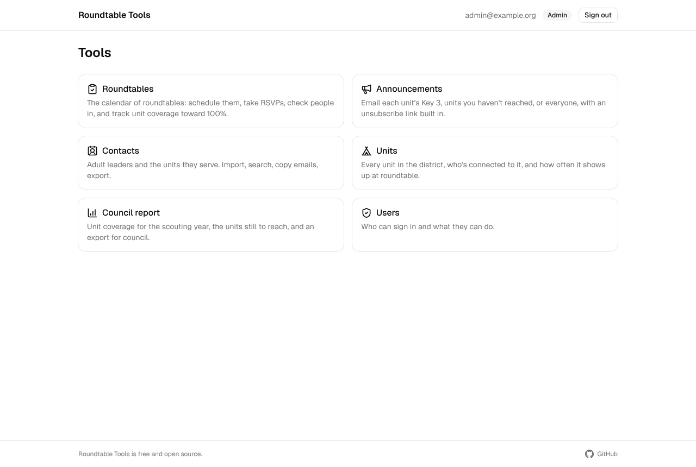

## What it does

### Contacts from your roster

Import the "all registered people" export from Scouting America's reports. The app keeps adults only, filters to your district, merges people who appear on several rows, and shows what will change before anything is saved. Re-importing a newer file updates people instead of duplicating them. Copy emails for a broad message, or export to CSV or Excel.

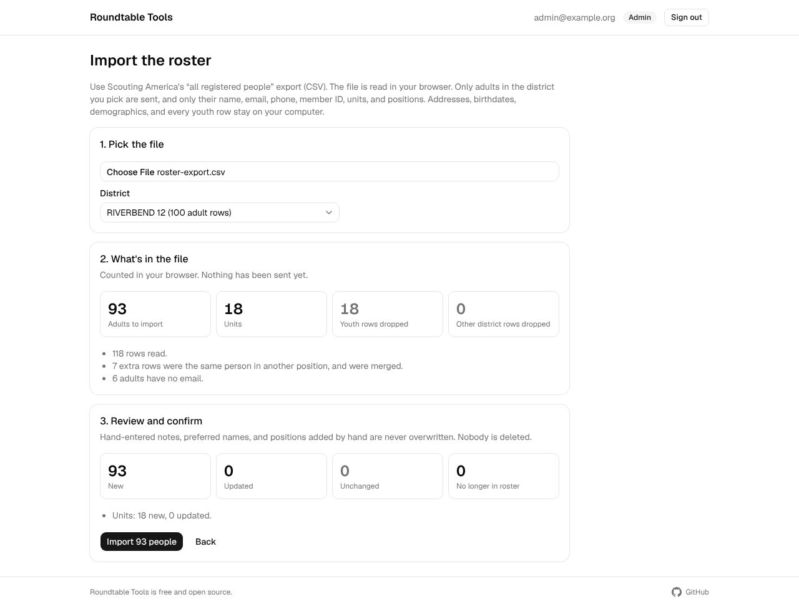

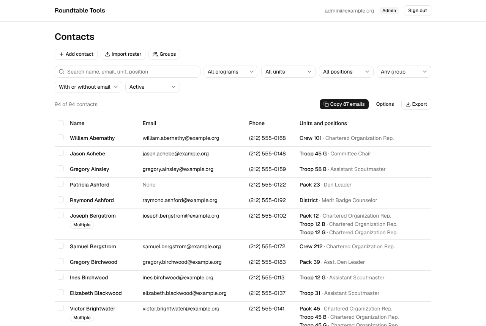

### Attendance at the door

Check people in on a phone: type a few letters of a name or unit and tap. Someone new? Add them as a walk-in in the same screen.

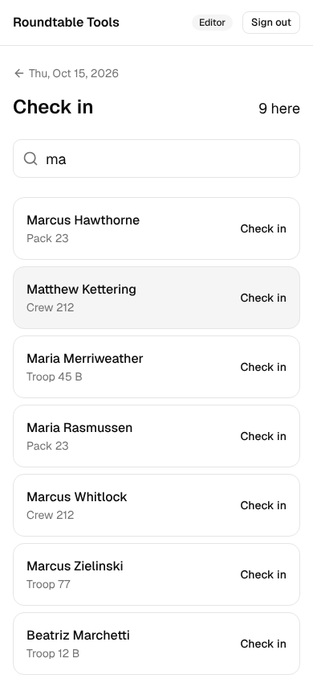

Or let people check themselves in. Each meeting has a QR code and link that open 30 minutes before it starts and close 30 minutes after it ends. People enter their email and last name and see only their own first name and units: they confirm which units they represent tonight, add one, or say they've left one. Anyone new, and any unit change, waits for an editor to approve it, so the roster never changes from what someone types at the door.

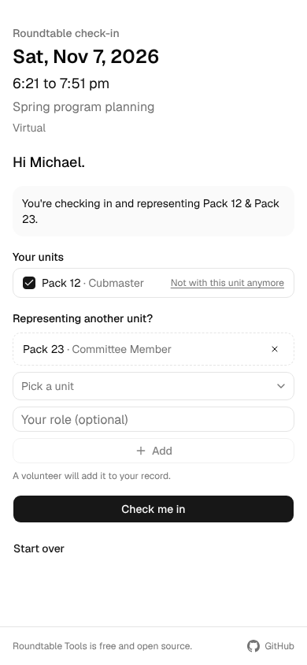

Meetings are listed by scouting year, held, upcoming, or cancelled, with start and end times and an export in the shape of the old sign-in sheet.

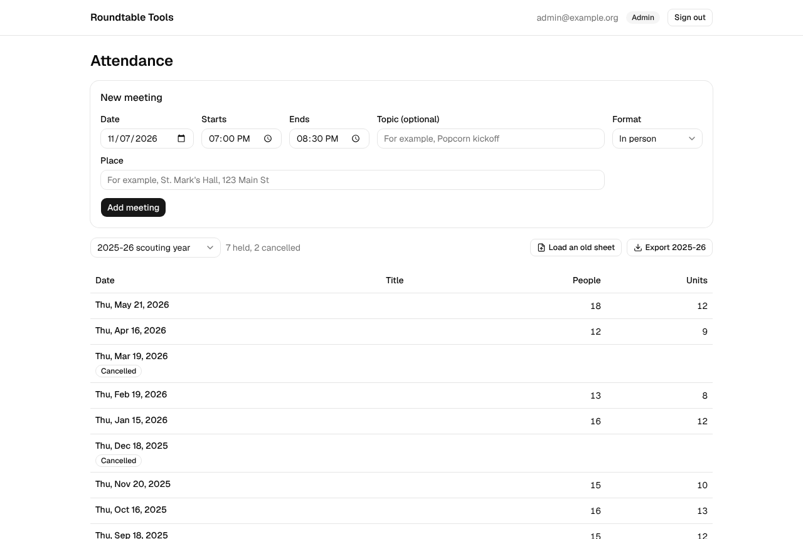

Each roundtable shows how many units were there, the year so far toward 100%, and which units came for the first time.

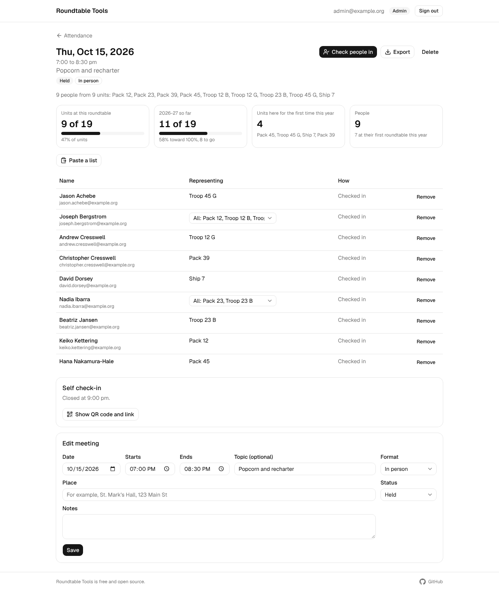

### Bring in what you already have

Load last year's sign-in sheet from Google Sheets. The app matches names to your contacts, including nicknames, first names alone, and typos, and asks you about anything it isn't sure of. For a virtual roundtable, paste the Zoom participant report.

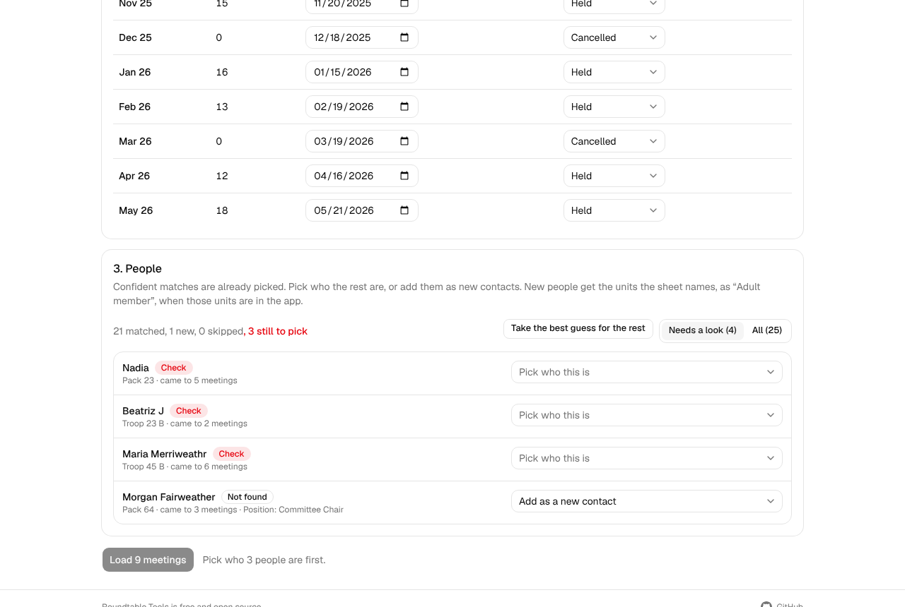

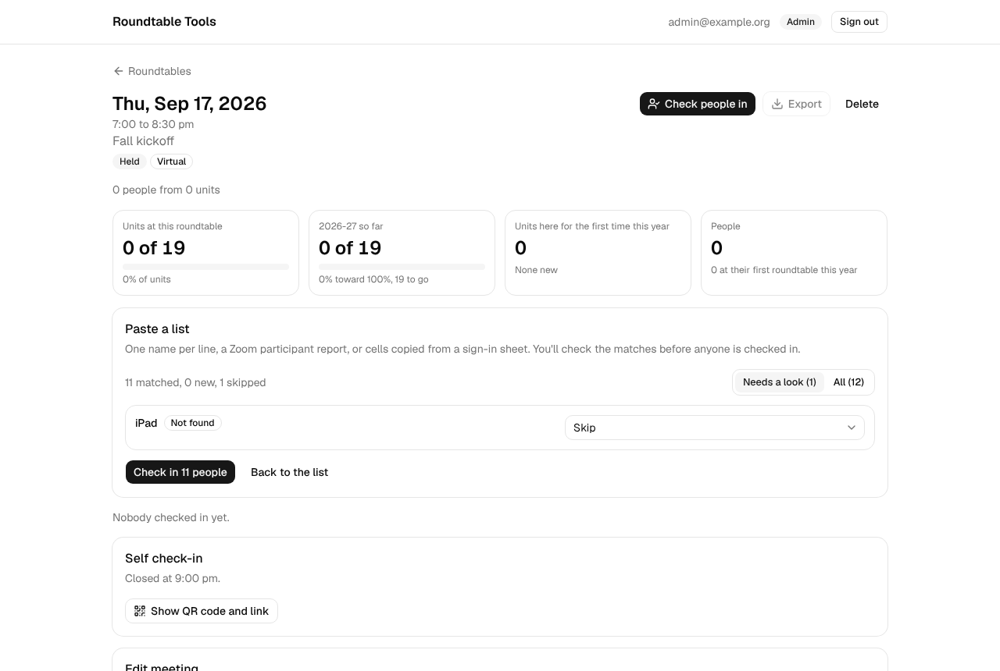

### Units

Load the council's unit membership report, and coverage is measured against the units that actually exist. Units that aren't on that list, like one typed in for a walk-in, are flagged. Each unit's page shows who came for it and how often.

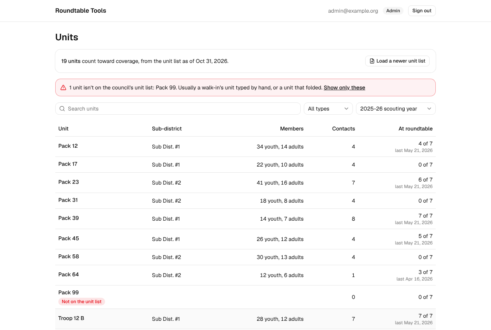

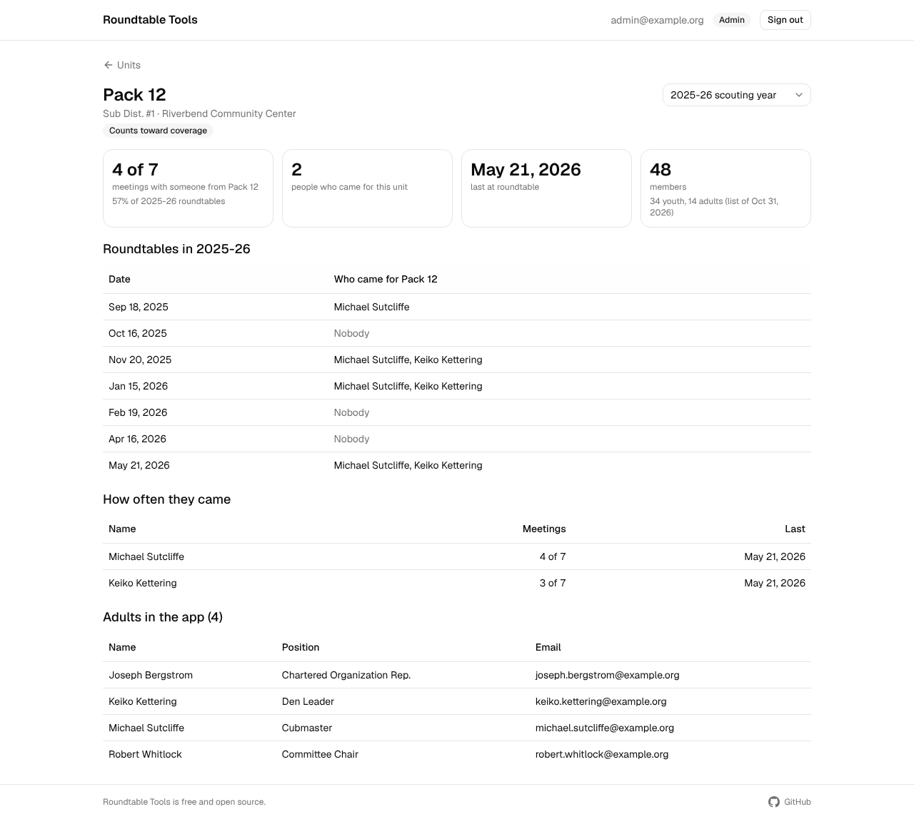

### The council report

The number council asks for: the share of units with at least one person at a roundtable this scouting year. Below it, the trends (new and returning people, how many came back from last year, packs and troops reached, each month next to the same month last year), the units you haven't reached yet with their leaders' emails one click away, and an Excel export.

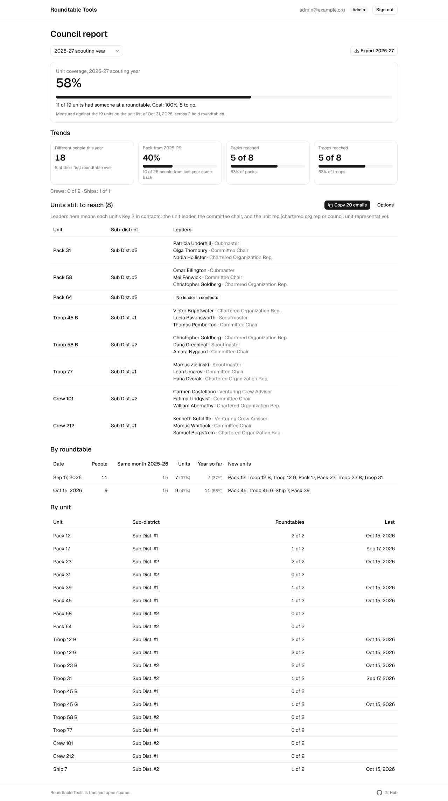

### Groups

See which lists each person is on, and build your own. Pick people in contacts and add them to a group, like a small test group or a committee, then filter by it or send an announcement to it. Each contact's page shows the lists they're on and why, and whether they'd get an announcement at all.

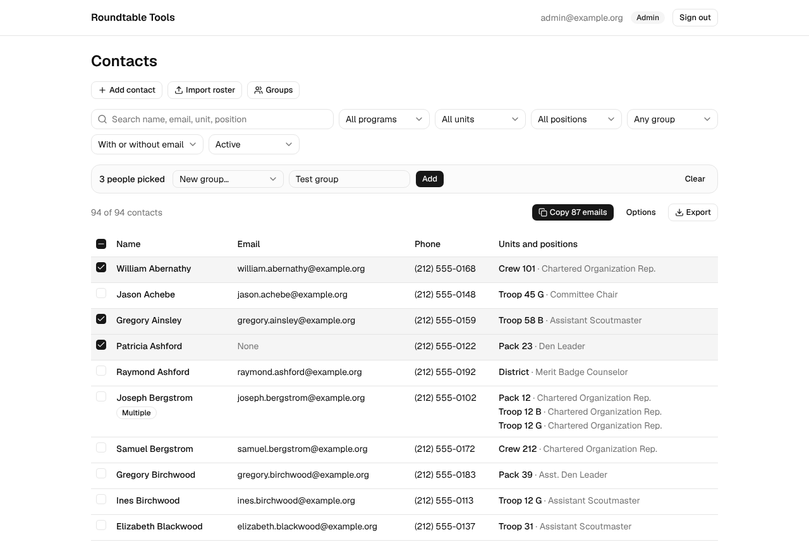

### Announcements

Email a group straight from contacts: everyone, unit leaders, the units you haven't reached this year, pack, troop, or district people, or a group you built. "Who's in it" lists exactly who gets it and who's left out and why (no email, unsubscribed, youth, a shared family address). Start from a template or a blank page, pick the meeting it's for to fill in the date, time, place, and an RSVP button, format with a toolbar (headings, lists, links, buttons), and watch an inbox and phone preview update as you type. Emails go out under your district's name, color, and logo through Resend. Every message has an unsubscribe link, replies come to whoever sent it, and anyone who unsubscribes is left out of later announcements and copied email lists.

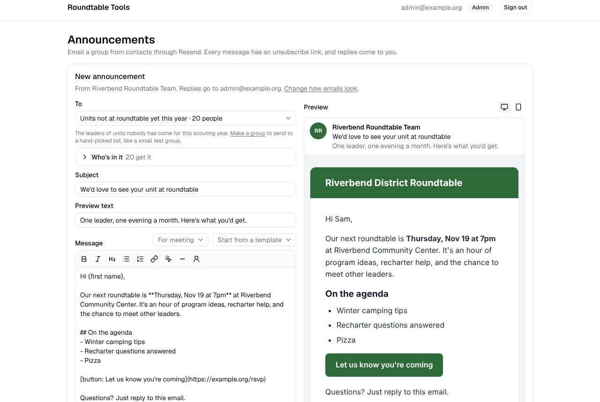

## Privacy

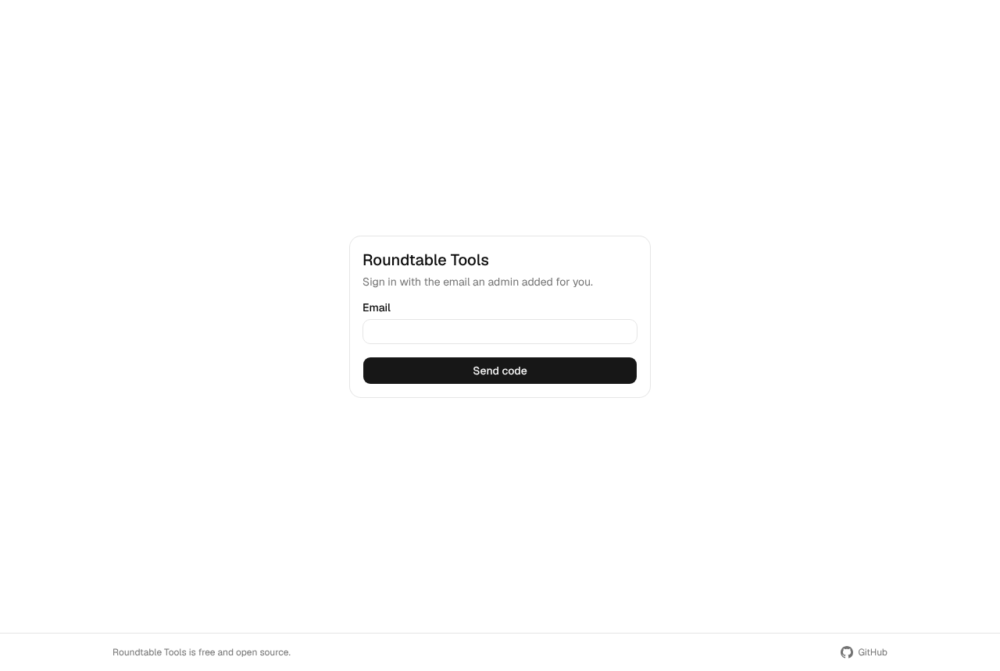

- Only people an admin adds can sign in, with a 6-digit code sent by email. There are no passwords.
- Youth records are never imported. Youth can be added by hand, and only with a parent or guardian email.
- Viewers can look and export, editors can change contacts and take attendance, and admins manage users and imports.

## Run it for your district

It runs on free tiers of Vercel, Neon Postgres, and Resend. [docs/SETUP.md](docs/SETUP.md) walks through it, and [docs/PLAN.md](docs/PLAN.md) has the decisions and what's built.

## Screenshots

The screenshots come from a made-up district: a script generates a roster, a unit list, last year's sign-in sheet, and a Zoom report, then uses the app the way a person would. To regenerate them after a change:

```bash
DEMO_DATABASE_URL=postgres://postgres@localhost:5432/roundtable_demo npm run demo:screenshots
```

The database must be a throwaway local one, because the script wipes it. You'll also need Playwright with Chromium.
